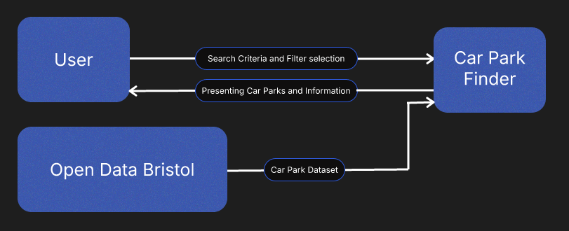

# Project Proposal

## Business Case

### Problem statement
Finding parking in Bristol can be a common issue. People might need to consult multiple sources to find car parks and the information about them. For example, you might need to search for the car park locations separately from practical details about them. My proposal addresses this in a centralised app that utilises the 'Car Parks' dataset from Open Data Bristol. You could find out practical useful information with easy filters that suit your exact need, it would allow users to quickly compare and find the car parks easily.

### Business benefits

#### 1. Time Saving
Using practical and useful filters on my application eliminates the time users spend searching for information from different sources

#### 2. Easier Comparison
My application will present the users actual viable results from their filters that you can easily compare practical information such as; Location, Capacity, Operating Times and if they are paid or not.

#### 3. Centralised Information
My application pools all of the data straight from Open Data's Bristol Car Parks dataset and presents it in a useful way. This will allow users to have quick access to it without scrolling through the dataset itself.

#### 4. Imporved Used Experience
I realised that the functionality of my proposal is only as good as the way the information is laid out. I will prioritise quick filters, clear displayed rows and text so users can quickly compare and also accessibility features.

#### 5. Potential Future Development
My app is only as big as the dataset allows, this means it is easily scalable for future developments. If they add more records or update it, it will directly improve the app. Additionally if you ever wanted to scale it outside of Bristol it is quite easy to do.

### Options Considered
Google Maps: This is the most widely used competitor. Users can search, view and get directions to car parks. But Google Maps is not built for car parks and may lack information that my proposed application would offer.

Just Park: Just Park is great and finding parking with clear filters but their focus is primarily on Reserved Parking and Rented Parking spots. For the purposes of exploring options and comparing information, my application is more well suited.

### Expected Risks

#### 1. Dataset Limitations
My dataset doesn't cover every single car park in Bristol and the dataset only has 51 records. Users could fail to find the perfect car park because of this.

#### 2. Data Accuracy
The information in the dataset could be wrong or outdated. Things like operation times and payment methods might be subject to change so the information needs to be up to date for users to make a desicion.

#### 3. Dependency on the Dataset
Since we don't own the data our whole application fails if the Dataset is moved or deleted. Both of which we have no control over.

#### 4. Useability and Accesability
The data needs to be in the same format for every car park for users to accurately and quickly compare them. Additionally application support for all sorts of devices and operating systems are needed as well as proper accessibility settings.

## Project Scope
The Car Park Finder is an application that will allow users to filter through and search for car parks using the Open Data Bristol Car Park Dataset and display the information in a clear and accessible way.

1. Get the data from the dataset
2. Display the data in a clear and accesable way
3. Allow users to search and filter car park results to their needs
4. Provide users with filters such as: location, capacity, payment method and operating times
5. Display only the car parks that are defined by the filters and searchbar
6. Display the car parks in a way that can be easily compared

