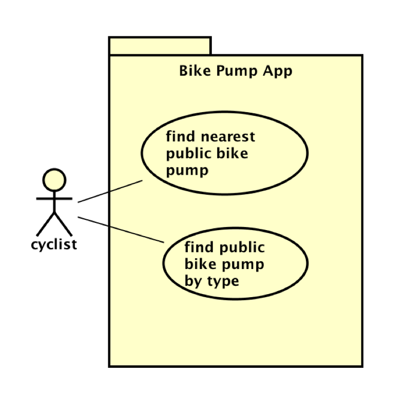

# Requirements

## User Needs

### User stories
-As a driver I want to search for car parks that are in a certain area
-As a driver I want to know if a car park has free parking or not
-As a driver I want to filter by capacity so I know there is likely to bew available parking spaces
-As a drive I want to view operating times beforehand so I know the car park is right for my journey
-As a driver I want to compare different car park information to find a suitable match

### Actors
User/Driver: The primary user that searches, filters and compares car parks
Administrator: Someone who is reasonable for correctly managing the dataset data for my app
Open Data Bristol: The provider for the data

### Use Cases

| UC1 | Search and Filter Car Parks | 
| -------------------------------------- | ------------------- |
| **Description** | Allows users to appropriately find a suitable car park based on their requirements |
| **Actors** | User/Driver |
| **Assumptions** | The dataset has been appropriately managed and is working |
| **Steps** | The user opens the application. The system displays the list of car parks. The user searches a car park or uses the various different filters to narrow down the results. The system handles the search and or filter queries. The system displays suitable car parks appropriate for the queries.|
| **Variations** | If no car parks are found the system displays a message notifying the user that no car parks have been found. |
| **Non-functional** | The filters and search bar should be easy to use and navigate. |
| **Issues** | The completeness and maintenance of the data relies entirely on Open Data Bristol |

| UC2 | View Car Parks | 
| -------------------------------------- | ------------------- |
| **Description** | Allows users to view different car park information in order to find a suitable match |
| **Actors** | User/Driver |
| **Assumptions** | The dataset has been appropriately managed and is working |
| **Steps** | The user opens the application. The system displays the list of car parks. The user selects a car park. The system displays the car park details such as; Operating Times, Capacity, Location.|
| **Variations** | If information is lacking for a certain car park it will replace the information with a quick defaulted note saying the information is not available. |
| **Non-functional** | The car park information should be clearly laid out and easy to read and navigate. |
| **Issues** | The completeness and maintenance of the data relies entirely on Open Data Bristol |

| UC3 | Compare Car Parks | 
| -------------------------------------- | ------------------- |
| **Description** | Allows users to compare different car park information in order to find a suitable match |
| **Actors** | User/Driver |
| **Assumptions** | The dataset has been appropriately managed and is working |
| **Steps** | The user opens the application. The system displays the list of car parks. The user can filter down results or just look at the list. The user can quickly compare car parks with easy to read columns with information such as; Operating Times, Capacity, Location.|
| **Variations** | If information is lacking for a certain car park it will replace the information with a quick defaulted note saying the information is not available. |
| **Non-functional** | The car park information should be clearly laid out and easy to read and navigate. |
| **Issues** | The completeness and maintenance of the data relies entirely on Open Data Bristol |

TODO: Your Use-Case diagram should include all use-cases.

## Software Requirements Specification
### Functional requirements
TODO: create a list of functional requirements. 
    e.g. "The system shall ..."
    Give each functional requirement a unique ID. e.g. FR1, FR2, ...
    Indicate which UC the requirement comes from.

### Non-Functional Requirements
TODO: Consider one or more [quality attributes](https://en.wikipedia.org/wiki/ISO/IEC_9126) to suggest a small number of non-functional requirements.
Give each non-functional requirement a unique ID. e.g. NFR1, NFR2, ...

Indicate which UC the requirement comes from.
